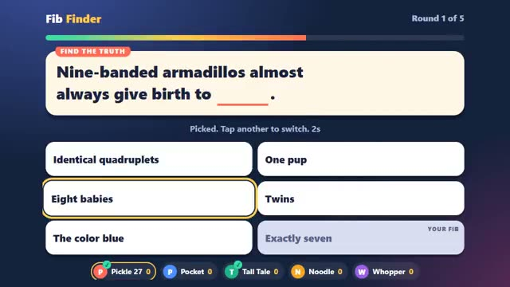

# Fib Finder

Write a fake answer. Spot the real one. A multiplayer starter game from [Multiplayer Agent](https://multiplayeragent.com): 2D, party, 3–10 players, with bots that fill empty seats.

## How it plays

A strange true fact appears with a word missing. Everyone writes a fake answer that sounds true. Then all the fakes and the real answer are shown together, with no names: pick the one you think is real. Finding the truth scores 1,000; every player who falls for your fake scores you 500. Five rounds a game.

**Controls:** Type your fake and press Enter; click or tap an answer to vote (or press 1–9).

## Make it yours in the Game Builder

Open the [Game Builder](https://multiplayeragent.com), choose **Start from a starter game** and pick Fib Finder. It opens as version 1 in your studio, ready to play and publish. Then ask for changes, for example:

- Make a question pack about movies
- Make the last round worth double points
- Add a vote for the funniest fake

## Run it yourself

1. Get a free publishable key (`pk_…`) at [multiplayeragent.com](https://multiplayeragent.com).
2. In `index.html`, put it in place of `pk_REPLACE_ME` in the `MP_CONNECT` block.
3. Open `index.html` in a browser. No build step and no server needed.

Without a key it still runs, offline against bots.

## How it is built

- One `index.html`. The comment at the top of the script maps the code and explains the multiplayer.
- **Hidden info:** Your fake is sealed so only the host can read it until the vote (the host builds the answer list).
- **Host-run rounds:** The host's browser runs the timers, builds the answer list and scores every vote; if it leaves, the next player takes over.
- **Bots:** Bots write fakes from each question's own list and vote, sometimes for the truth.
- **Leaderboard:** Each player's best game, in points.
- The facts are in the `QUESTIONS` section: `q` with `____` for the blank, `a` the real answer, `f` fakes for the bots.
- `?attract` runs it offline with bots only. The preview video is recorded from it.

## License

MIT.
